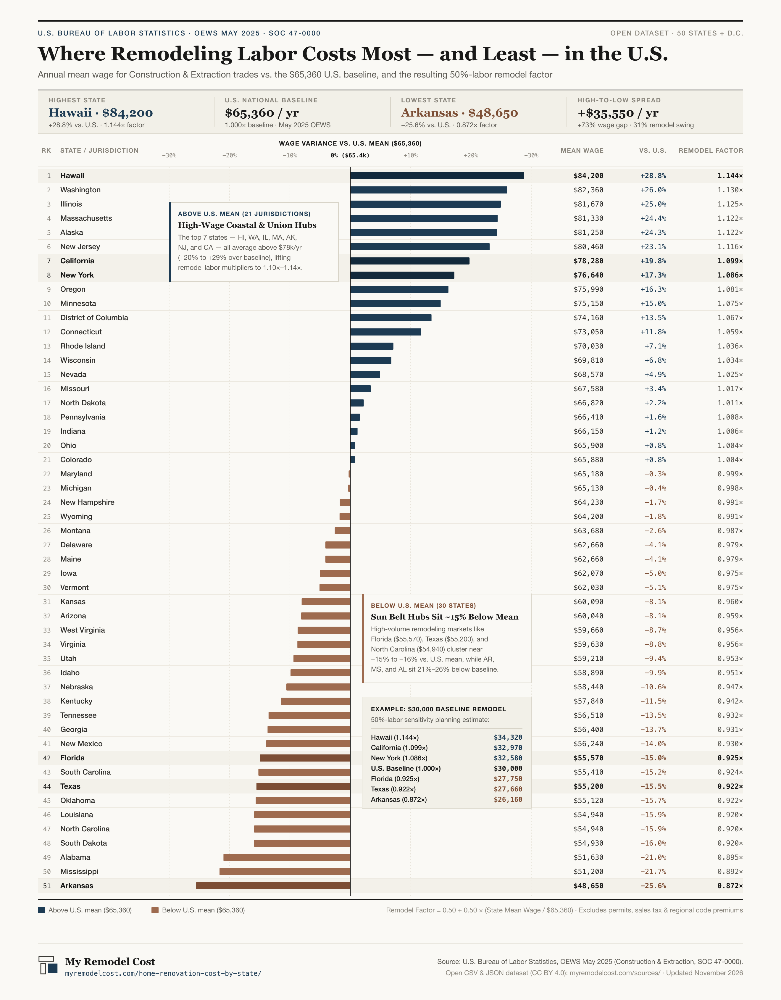

# US Residential Remodeling Cost Benchmarks & State Construction Labor Index (2026)

Open, reproducible datasets published by **[My Remodel Cost](https://myremodelcost.com/)** for researchers, journalists, housing analysts, and homeowners.

## What's Included

| File | Description | Records | Interactive Tool |
| --- | --- | ---: | --- |
| `data/state-construction-labor-index-2025.csv` | May 2025 BLS OEWS Construction & Extraction (`SOC 47-0000`) annual mean wages, state-to-US ratios, and disclosed 50% labor-share sensitivity factors (capped `0.75x–1.25x`) across all 50 states + DC. | 51 | [Home Renovation Cost by State](https://myremodelcost.com/home-renovation-cost-by-state/) |
| `data/state-construction-labor-index-2025.json` | Structured JSON version of the May 2025 state labor index with full metadata and limitations. | 51 | [Sources & Data Register](https://myremodelcost.com/sources/#state-labor-data) |
| `data/remodeling-cost-benchmarks-2026.csv` | Selected 2026 US remodeling planning ranges with project scope, units, source publisher, source date, URL, and stated limitations kept separate by methodology. | 38 | [All 15 Cost Models & Bid Audit Tools](https://myremodelcost.com/) |
| `charts/us-construction-labor-index-2025.png` | High-resolution (`2640×3380`, CC BY 4.0) diverging chart of all 50 states + DC vs. the `$65,360` U.S. mean (also included as vector `.svg`). | 51 | [State Labor Index Visualization](https://myremodelcost.com/home-renovation-cost-by-state/) |

## Methodology & Key Limitations

- **National baseline wage (May 2025 BLS OEWS, SOC 47-0000):** `$65,360` annual mean.
- **Labor-weighted factor formula:** `0.50 + 0.50 × (state_mean_wage / 65360)`, capped between `0.75` and `1.25`.
- **Important limitation:** The state index models labor-market wage sensitivity only. Material supply chains, contractor overhead/profit, local permit schedules, sales taxes, and regional code mandates (e.g., California Title 24, Florida HVHZ hurricane codes) remain outside the wage ratio.
- **State-specific statutory & licensing guides:**
  - [California Remodel Cost & CSLB Rules](https://myremodelcost.com/home-renovation-cost-by-state/california/) (`1.099x`, B&P Code §7159.5 `$1,000`/10% deposit cap)
  - [Texas Remodel Cost & Licensing Rules](https://myremodelcost.com/home-renovation-cost-by-state/texas/) (`0.922x`, TDLR/TSBPE trade checks & Property Code Ch. 53)
  - [Florida Remodel Cost & DBPR Rules](https://myremodelcost.com/home-renovation-cost-by-state/florida/) (`0.925x`, F.S. §489.126 deposit timelines & Ch. 713 lien law)

## Interactive Tools Built on This Data

- **Single Bid Audit:** [Contractor Quote Checker](https://myremodelcost.com/contractor-quote-checker/)
- **Multi-Bid Audit:** [Compare 3 Contractor Bids Side by Side](https://myremodelcost.com/compare-contractor-bids/)
- **Free Zero-Tracking Partner Embed:** [Embeddable Calculator Widget](https://myremodelcost.com/embed/)
- **Anonymous First-Party Bid Collection:** [Submit an Anonymous Remodel Bid](https://myremodelcost.com/submit-bid/)

## Suggested Citation

> My Remodel Cost. *US Residential Remodeling Cost Benchmarks & May 2025 State Construction Labor Index.* Updated November 2026. https://myremodelcost.com/sources/

## Verification & Corrections

- Full methodology: https://myremodelcost.com/methodology/
- SHA-256 checksums & source register: https://myremodelcost.com/sources/
- Corrections & data feedback: `editor@myremodelcost.com`
